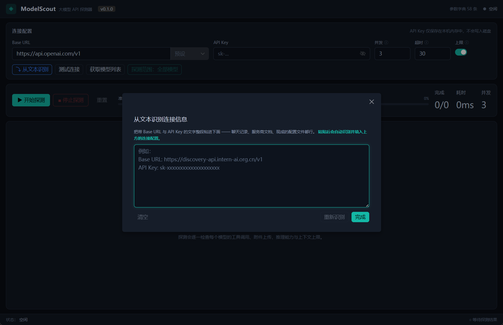
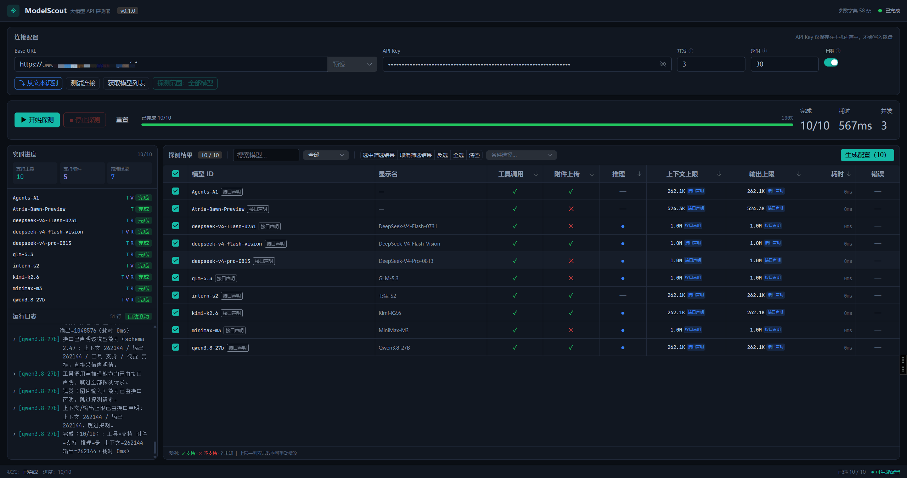
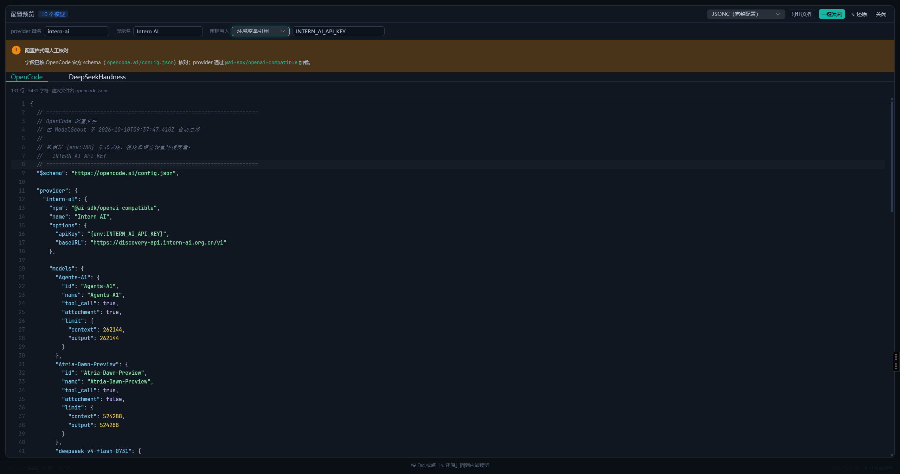

<div align="center">
  
  <h1>ModelScout Desktop</h1>
  <p>大语言模型 API 能力探测与配置生成工具</p>
</div>

支持连接 OpenAI 兼容的 API 服务，批量检测模型的工具调用、图片输入、推理能力及 Token 限制，并根据探测结果生成 OpenCode、DeepSeek Harness（dsh）配置文件，支持一键写入本机配置（带左右对比预览与自动备份）。

<p align="center">
  <a href="../../releases/latest"></a>
</p>

<p align="center">
  <a href="https://github.com/Huaxidesu/ModelScout-Mobile"></a>
  <a href="https://tauri.app/"></a>
  <a href="https://vuejs.org/"></a>
  <a href="https://www.rust-lang.org/"></a>
  <a href="LICENSE"></a>
</p>

## 项目简介

本项目提供**桌面版**与**手机版**两个版本，功能一致，本仓库为桌面版（Windows / Linux）；手机版见 [ModelScout Mobile](https://github.com/Huaxidesu/ModelScout-Mobile)。

ModelScout 是一款大语言模型 API 探测与配置生成工具，适用于各类模型服务平台及自建模型服务。

使用大模型 API 时，不同模型支持的功能和参数限制可能有所不同。例如，部分模型支持图片识别或工具调用，不同模型能够处理的文本长度也存在差异。这些信息通常需要查阅服务商文档或通过实际请求进行确认。

ModelScout 可以自动获取 API 服务中的模型列表，批量检测模型支持的功能及参数限制，并根据检测结果生成 OpenCode、DeepSeek Harness（dsh）等工具所需的配置文件，减少手动查询、测试和配置的工作量。

主要功能：

- **自动获取模型**：输入 API 地址和密钥，获取服务中可用的模型列表。
- **检测模型能力**：识别模型是否支持图片输入、工具调用及推理功能。
- **查询参数限制**：获取模型的上下文窗口和最大输出长度。
- **批量自动探测**：同时检测多个模型，实时展示探测进度与结果。
- **生成配置文件**：选择需要使用的模型，生成对应工具的配置文件，支持复制和导出。
- **一键填写（OpenCode / dsh）**：把探测结果直接写进本机配置文件——空文件自动补全完整配置，已有配置最小合并、**OpenCode 手写的注释原样保留**；自动识别 OpenCode 配置的 V1/V2 世代（可手动切换），V2 下支持配置推理强度档位、思考预算等参数；写入前左右对比预览、自动备份，确认后才写盘。
- **配置管理（编辑配置）**：一键识别本机 OpenCode / dsh 配置里的全部 provider，逐个编辑参数（是否思考、能否上传附件、上下文长度、最大输出等），并可绑定密钥、删除或存入 Key 管家。
- **探测 ↔ Key 管家联动**：探测完一键把密钥存入 Key 管家；也可从 Key 管家选密钥直接发起探测并记录结果。
- **主题切换**：设置中可选 默认 / 浅色 / 深色 / GitHub 四套配色，或自定义——20 个颜色令牌全部可改，选择即生效并自动保存。
- **手动调整结果**：对无法自动识别或存在偏差的参数进行修改。

## 下载与安装

前往 [Releases](../../releases/latest) 下载对应平台的发行版本。

| 操作系统 | 发行文件 | 安装方式 |
|---|---|---|
| Windows | `ModelScout-<版本>-windows-x64-portable.zip` | 解压后运行 `ModelScout.exe` |
| Windows | `ModelScout_<版本>_x64-setup.exe` | 运行安装程序，无需管理员权限 |
| Linux | `ModelScout_<版本>_amd64.AppImage` | 添加执行权限后运行 |
| Linux | `ModelScout_<版本>_amd64.deb` | 通过 `dpkg` 安装 |

**系统要求**：Windows 10 / 11 或受支持的 Linux 发行版。

Windows 便携版需要完整解压压缩包，并保留可执行文件与 `resources` 目录的相对位置。

### 运行环境

Windows 版本依赖 Microsoft Edge WebView2 Runtime。如果系统尚未安装，应用会提示并提供官方下载页面。

Linux AppImage 版本可通过以下命令添加执行权限：

```bash
chmod +x ModelScout_*.AppImage
```

## 使用方法

### 1. 配置 API 连接

启动应用后，填写 API Base URL 和 API Key。

支持通过「从文本识别」功能，从包含连接信息的文本中提取 API 地址及密钥，包括服务商提供的配置示例或已有配置文件。

<p align="center">
  
</p>

### 2. 执行模型探测

点击「开始探测」，应用将获取模型列表，并对选定模型执行能力与参数检测。

探测过程中可实时查看执行进度、状态及日志，也可以随时停止任务。

默认并发数为 3，可根据 API 服务的速率限制进行调整。遇到 HTTP 429 错误时，建议将并发数降低至 1–2。

<p align="center">
  
</p>

### 3. 生成配置文件

探测完成后，选择需要配置的模型，并在「配置预览」区域选择目标工具及输出格式。

生成结果支持：

- 预览配置内容
- 复制到剪贴板
- 导出配置文件
- 放大配置预览区域

对于未能自动识别的参数，可双击结果表格中的对应字段进行编辑。

<p align="center">
  
</p>

### 4. 一键填写到本机配置

点击配置预览区的「⚡ 一键填写」，可把探测结果直接写进目标工具的本机配置文件，不用手动复制粘贴：

- **OpenCode**：目标为 `~/.config/opencode/opencode.json`（已存在 `.jsonc` 时跟随）；空文件补全完整配置，已有配置只并入探测到的 provider，**你手写的注释原样保留**，v1 / v2 两种配置格式自动跟随文件本身。
- **DeepSeek Harness（dsh）**：目标为 `~/.dsh/profiles/<profile>/cordis.patch.yml`，密钥以环境变量引用写入。
- 写入前弹出**左右对比预览**（类似 VSCode，红绿标注差异），可先逐模型调整参数（思考 / 附件 / 上下文 / 输出），确认后才写盘，并自动备份原文件为 `<原文件名>.modelscout.bak`。

## 配置管理

顶部标签页可切换到 **配置管理**，无需探测即可直接维护本机配置：

- **一键识别**：扫描本机 OpenCode / dsh 配置文件，列出全部 provider（标注 v1 / v2 格式与所在文件）。
- **编辑**：逐个 provider 修改模型参数——是否思考、能否上传附件、上下文长度、最大输出等，确认后直接写回配置文件（自动备份）。
- **绑定密钥 / 删除 / 加入 Key 管家**：从 Key 管家选密钥写入 provider，或把配置里的明文密钥收进 Key 管家统一管理。

与「探测 ↔ Key 管家」联动配合：探测完的模型可一键加入 Key 管家；Key 管家的密钥可一键填入对应工具。

## 设置（主题）

顶栏右侧的齿轮按钮打开设置，可切换主题：

- **默认**（青绿 · 暗色）、**浅色**、**深色**（中性黑 · 蓝）、**GitHub**（Primer 浅色风格）；
- **自定义**：背景、边框、文字、品牌与语义色共 20 个颜色全部可改，初始值取自「默认」配色，可一键恢复；
- 选择即生效并自动保存，重启后保持；自定义主题的明暗按背景亮度自动判断。

## 探测能力

| 探测项目 | 说明 |
|---|---|
| 工具调用 | 检测 API 对工具调用请求的支持情况 |
| 图片输入 | 检测 API 对图片输入请求的支持情况 |
| 推理能力 | 根据模型名称及响应特征识别推理模型 |
| 上下文窗口 | 查询模型支持的上下文 Token 上限 |
| 最大输出 | 查询单次响应允许的最大输出 Token 数 |

探测结果基于模型参数字典、测试请求及服务端响应综合判断。由于不同服务商的接口实现可能存在差异，部分能力或参数无法准确识别。

详细说明参见 [探测原理与限制](../../wiki/探测原理与限制)。

## 常见问题

### 探测结果与官方文档不一致

不同服务商可能对模型参数、能力支持及 API 接口进行调整。探测结果仅供参考，具体限制应以实际使用的 API 服务商文档为准。

### 部分参数显示为「未知」

当 API 服务未返回可解析的参数限制时，相应字段会标记为「未知」。

可参考服务商文档，并通过双击结果表格中的对应字段手动填写。

### 探测过程中出现 HTTP 429 错误

HTTP 429 表示请求受到服务端速率限制。

可适当降低探测并发数，或在服务端限制解除后重新执行探测。

### 生成的配置无法正常使用

目标工具的配置结构及字段要求可能随版本变化。建议确认工具版本，并核对生成的配置内容。

详细说明参见 [配置生成说明](../../wiki/配置生成说明)。

更多信息参见 [常见问题](../../wiki/常见问题)。

## Key 管家（测试版）

顶部标签页可切换到 **Key 管家**：批量粘贴导入 API Key、自动识别平台、检测有效性与余额、查看余额历史，并可选启用主密码加密保存。

密钥默认**不落盘**，关闭应用即清空；启用「本地保存」后才用主密码加密写入本机（argon2id + AES-256-GCM，主密码无法找回）。

> **测试版功能**：该模块仍在打磨中，接口与界面可能变化，建议不要用于正式环境的密钥管理。

完整说明参见 [Key 管家](../../wiki/Key管家)。

## 开发文档

项目基于 Tauri 2、Vue 3、TypeScript 和 Rust 开发。

- **前端**：负责用户界面、状态管理及配置生成。
- **后端**：负责 API 请求、模型探测、并发调度与错误处理。
- **数据安全**：API Key 仅在运行期间使用，不写入本地持久化存储；生成的配置文件通过环境变量引用密钥。

源码构建、项目结构、技术实现及测试说明参见 [开发指南](../../wiki/开发指南)。

## 许可证

本项目采用 [PolyForm Noncommercial 1.0.0](LICENSE) 许可证。

允许在许可证规定的非商业范围内使用、修改和分发本项目。商业用途需要取得额外授权。

完整许可条款参见 [LICENSE](LICENSE)。